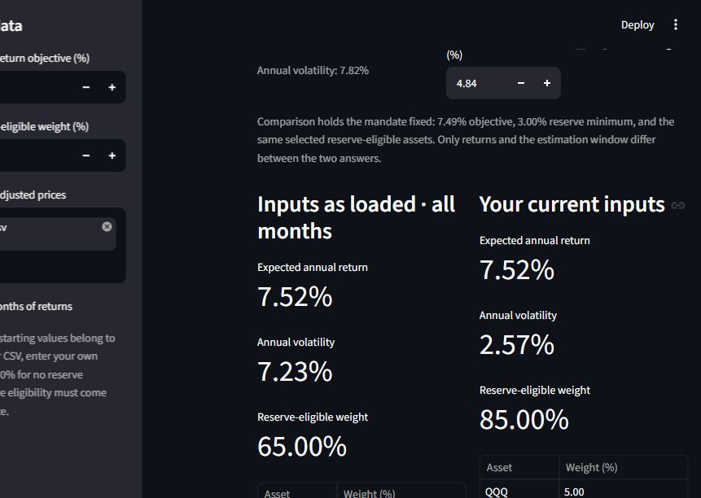
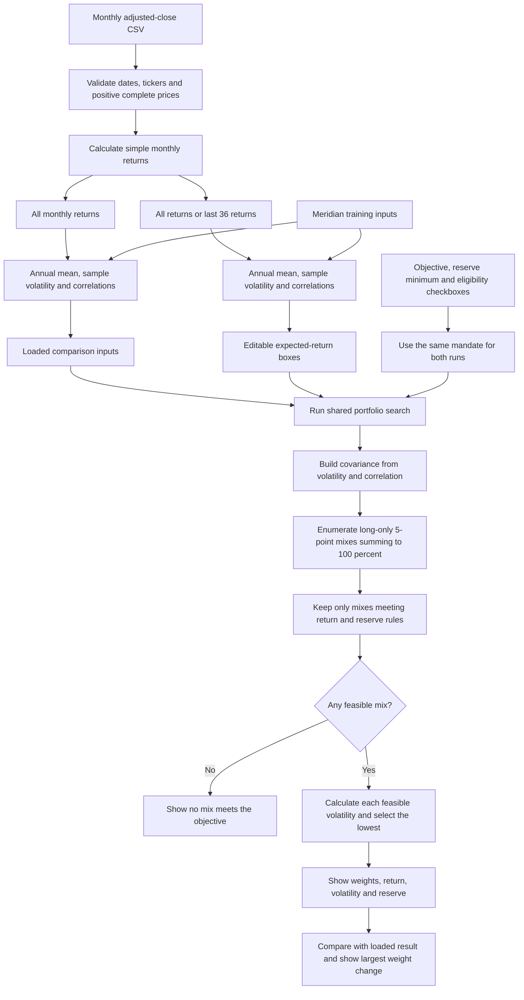

> **AI-use disclosure:** Prepared with OpenAI Codex assistance. Verify sources, calculations and conclusions.
>
> **Educational purposes only. Not financial or investment advice.**

# Lab 15 — Portfolio app and fund universe

Prepared October 22, 2026. The app searches every long-only allocation in 5-percentage-point steps and selects the feasible mix with the lowest volatility. It uses the functions in `portfolio.py`; the page does not duplicate the return, risk, estimation or search calculations.

## Run the app

Open PowerShell and paste:

```powershell
cd C:\Users\mac10\finance-ai-work\Lab_15
..\Lab_14\.venv\Scripts\python.exe portfolio.py
..\Lab_14\.venv\Scripts\python.exe -m streamlit run app.py --server.port 8502
```

Open http://127.0.0.1:8502/ if the browser does not open automatically. If the app is already running, use that page instead of starting a second copy. Stop a server you started in your terminal with Ctrl+C.

The existing Lab_14 environment contains Streamlit. The engine itself is standard-library-only. On another computer, install `requirements.txt`, then run `python -m streamlit run app.py`. `run_app.ps1` is an optional local launcher. Run the verification suite with:

```powershell
..\Lab_14\.venv\Scripts\python.exe test_lab15.py
```

## Meridian result and one-point change

The unmodified Lab 14 baseline output and its self-test output match byte for byte. They are still available by running `python portfolio.py` and `python portfolio.py --self-test`.

The app starts with Meridian's course-authored training assumptions: expected-return objective 6.5%, reserve minimum 3%, and bills plus the 10-year Treasury note reserve-eligible. These are not market forecasts or the student's confirmed Project 2 mandate.

| Input or output | Loaded Meridian | Equity expected return lowered by 1 point |
| --- | ---: | ---: |
| Equity expected return | 8.00% | 7.00% |
| Bills weight | 0.00% | 0.00% |
| 10-year Treasury weight | 20.00% | 10.00% |
| IG bond weight | 25.00% | 10.00% |
| Equity weight | 55.00% | 80.00% |
| Portfolio expected return | 6.51% | 6.53% |
| Portfolio volatility | 9.44% | 12.94% |
| Reserve-eligible weight | 20.00% | 10.00% |
| Largest absolute weight change | 0.00 points | 25.00 points |
| Feasible mixes | 142 | 18 |
| Total mixes tested | 1,771 | 1,771 |

Only equity's expected return changes in this probe. All volatilities, correlations, mandate thresholds and eligibility flags stay fixed. With less assumed return from each dollar of equity, the grid solution uses more equity to reach the same return threshold. The saved base remains unchanged. This is sensitivity to an assumption, not evidence that a portfolio will achieve its return objective.

To reproduce on the page, change global equity's return box from 8.00 to 7.00 and press Enter; then restore 8.00.

## How the loaded comparison works

Both columns use the current sidebar objective, reserve minimum and checked reserve-eligible assets. The left column always uses unedited loaded return and risk inputs; for a CSV it uses all available monthly returns. The right column uses the editable return boxes and the selected estimation window. Thus changing the sidebar mandate or eligibility changes BOTH answers. This convention isolates the effect of changed estimates and is stated on the page.

For a CSV, switching to the last 36 months resets the return boxes to the recent estimates. Volatilities and correlations also update. Neither the original file nor the all-month comparison estimates are changed. Changing back resets the boxes to all-month estimates.

## The six funds selected for practice

The student selected QQQ, ONEQ and VUG, then explicitly chose to add BIL, IEF and LQD. These six funds span the course's roles, though the three equity funds overlap and do not provide the broad global equity exposure of the example VT. This is a course universe, not a recommendation.

| Ticker | Fund name | Role | Fund information source |
| --- | --- | --- | --- |
| QQQ | Invesco QQQ ETF | Nasdaq-100 equity exposure | [Invesco](https://www.invesco.com/qqq-etf/en/home.html) |
| ONEQ | Fidelity Nasdaq Composite Index ETF | Nasdaq Composite equity exposure | [Fidelity](https://digital.fidelity.com/prgw/digital/research/quote/dashboard/summary?symbol=ONEQ) |
| VUG | Vanguard Morningstar Growth ETF (formerly Vanguard Growth ETF) | U.S. large-cap growth equity | [Vanguard](https://advisors.vanguard.com/investments/products/vug/vanguard-morningstar-growth-etf) |
| BIL | State Street SPDR Bloomberg 1-3 Month T-Bill ETF | Cash/reserve proxy | [State Street](https://www.ssga.com/us/en/individual/etfs/state-street-spdr-bloomberg-1-3-month-t-bill-etf-bil) |
| IEF | iShares 7-10 Year Treasury Bond ETF | Government bonds | [iShares fact sheet](https://www.ishares.com/us/literature/fact-sheet/ief-ishares-7-10-year-treasury-bond-etf-fund-fact-sheet-en-us.pdf) |
| LQD | iShares iBoxx $ Investment Grade Corporate Bond ETF | Investment-grade corporate bonds | [iShares](https://www.ishares.com/us/products/239566/lqd-ishares-iboxx-investment-grade-corporate-bond-etf) |

**Confirmed practice mandate (October 22, 2026):** annual expected-return objective **7.49%**, held fixed across both windows; reserve minimum **3% in BIL only**. The student chose the all-month average of the six funds as the target: the exact arithmetic average is 7.4943859496%, rounded to 7.49%. This is a historical estimate selected for coursework, not evidence of a client's required return or a forecast. The student explicitly selected the course practice reserve minimum. IEF does not count toward this chosen reserve rule.

Upload `prices.csv`, enter 7.49% for the objective and 3.00% for the reserve minimum, and check BIL only. All CSV eligibility boxes start unchecked because a price file does not contain mandate permissions. A positive reserve minimum with no eligible assets correctly produces no feasible mix. Keep the target and reserve settings unchanged when switching to the last 36 months.

## Own-universe results under the confirmed mandate

Both runs use the same saved prices, 7.49% target, 3% minimum in BIL, and 5-percentage-point allocation grid. All-month estimates use 59 returns ending November 2021 through September 2026; recent estimates use 36 returns ending October 2023 through September 2026. Return, volatility and correlations are re-estimated together; this comparison does not isolate one input.

| Weight or output | All months | Last 36 months | Change (recent minus all) |
| --- | ---: | ---: | ---: |
| QQQ weight | 10.00% | 5.00% | -5.00 points |
| ONEQ weight | 20.00% | 0.00% | -20.00 points |
| VUG weight | 5.00% | 10.00% | +5.00 points |
| BIL weight | 65.00% | 85.00% | +20.00 points |
| IEF weight | 0.00% | 0.00% | 0.00 points |
| LQD weight | 0.00% | 0.00% | 0.00 points |
| Expected annual return (estimate) | 7.52% | 7.52% | +0.01 points before rounding |
| Annual volatility (estimate) | 7.23% | 2.57% | -4.66 points |
| Reserve-eligible weight | 65.00% | 85.00% | +20.00 points |
| Meets return and reserve thresholds | Yes | Yes | Same thresholds |
| Feasible mixes / tested | 20,533 / 53,130 | 39,774 / 53,130 | — |

**Largest absolute weight change: 20 percentage points**, tied between ONEQ (20% to 0%) and BIL (65% to 85%). Both displayed returns round to 7.52%; their unrounded values are 7.5162380442% and 7.5238465988%.

The actual Streamlit page was checked with `prices.csv` uploaded, objective 7.49%, reserve minimum 3%, and BIL alone checked. Its all-month and last-36 answers matched the engine results above, including the 20-point change. The page is left on the last-36 comparison.



`Lab_15_own_universe_results.json` retains full estimates, mandate settings, allocation results and the source-file hash. `Lab_15_own_universe_output.txt` records the visible calculation output. `verify_own_universe.py` independently checks monthly estimates, annual sample covariance, all 53,130 allocations, feasible counts and the winning mix using NumPy and a separate enumeration method. Both windows passed. Run it with the Lab_14 environment:

```powershell
..\Lab_14\.venv\Scripts\python.exe verify_own_universe.py
```

## Estimation risk and my call

Estimation risk means the returns, volatilities and correlations used by the search may differ from future outcomes. The search treats its inputs as exact: changing an estimate can make many allocations feasible or infeasible, so a small input change can produce a large allocation change. The 5-point grid also makes movements occur in jumps.

In these data, recent equity return estimates are higher and BIL's estimate rises from 3.66% to 4.37%. Under the recent estimates, less equity is needed to reach the fixed 7.49% target, and the search selects 85% BIL instead of 65%. Estimated volatilities and correlations also change, so the 20-point movement cannot be attributed to returns alone. The lower estimated portfolio volatility is not proof of lower future risk.

**My call, selected by the student:** “Pilot: use it provisionally; adopt only after the target and allocation hold up across other reasonable estimation windows.” The 20-point movement supports treating the allocation as provisional. Other reasonable windows have not yet been tested; the adoption condition has not been met. The historical-average target also needs a client-based justification before this becomes a real mandate.

## Accuracy check and partner attack status

The student's request was to make sure the work was accurate. Independent numerical checks passed for both estimation windows. No actual partner-changed estimate or partner question has been supplied, so the partner exercise remains **pending**.

An additional **AI technical stress, not partner feedback**, lowered only all-month QQQ's annual return estimate by one percentage point, from 16.0396165939% to 15.0396165939%. The target, reserve, volatilities, correlations and other returns stayed fixed. The result was QQQ 20%, ONEQ 10%, VUG 5%, BIL 65%, IEF 0%, LQD 0%; expected return 7.4944240725%, volatility 7.2769696318%, reserve 65%. The largest weight change was 10 points. This does not replace a partner's independent challenge, and the saved base inputs were unchanged.

After the real partner exercise, write your own two sentences identifying the exact input changed, old and new values, observed allocation change, and whether the objection changes your call. Do not report the AI stress as a partner activity.

## Prices and estimation method

`prices.csv` has date first, then QQQ, ONEQ, VUG, BIL, IEF and LQD. Each value is adjusted close in USD per share. It contains 60 complete calendar months, October 2021 through September 2026, using the last available trading date in each month. The partial month of October 2026 is excluded. The first and last price dates are October 29, 2021 and September 30, 2026.

The source is Yahoo Finance's chart endpoint, daily interval with its explicit `adjclose` field. The final daily observation in each month is selected to make the requested monthly price series. This was downloaded programmatically, not claimed as a manual visit to the Monthly tab. All six month-end dates align. No missing prices were filled and no prices were invented. The provider's adjustments are retained; split and dividend adjustments are not applied a second time. Full provider precision is retained in the CSV.

There are 59 monthly returns from 60 prices. For each fund the engine calculates simple returns, price this month divided by price last month minus one. Expected annual return is the arithmetic monthly mean multiplied by 12; annual volatility is the sample monthly standard deviation multiplied by the square root of 12. Correlations are Pearson correlations over the same selected monthly returns. These annualizations are estimates and assume the monthly inputs can be scaled in this way; historical averages are not forecasts or guaranteed future returns. The annual mean is not compound annual growth (CAGR).

The last-36 switch uses 36 returns and therefore 37 prices. Dates must be chronological, unique and consecutive by month. Missing, nonpositive or nonfinite prices, duplicate tickers and zero-variation return series are refused. The CSV's two comment lines contain the disclosures; the engine ignores lines starting `#`. Other readers may need a comment option, for example `pd.read_csv("prices.csv", comment="#")`.

## Mermaid flowchart

This chart is AI-generated. Compare it with the paper diagram you draw yourself; it is not evidence that the no-AI paper exercise was completed.



## Limits and work to complete personally

The result is the best tested 5-point mix, not a continuous optimum. Six assets produce 53,130 grid mixes. A 3% reserve minimum rounds up to at least 5% on this allocation grid. Ties retain the first mix found in asset order. Higher or lower expected returns may change the solution abruptly. Volatility is not a loss limit, and the app does not check turnover, rebalancing, rolling realized returns, trading costs or every IPS rule.

The automated suite checks preservation of Lab 14 output, the Meridian minimum, the one-point probe, infeasibility, reserve boundaries, a separately calculated small-grid minimum, sample estimates, 36-return selection, malformed data, uploaded data and Streamlit control updates. Synthetic test fixtures are labelled and are not used as market data. Results are saved in `Lab_15_test_output.txt`; baseline console output and numeric evidence are also saved alongside it.

The mandate and pilot decision are confirmed. The student still needs to complete the no-AI paper/code explanation, genuine partner question/attack, and personal reflection. Record only work actually performed:

- My practice annual return objective and reason: 7.49%, the rounded all-month six-fund average selected for this exercise; client justification remains to be developed.
- My practice reserve rule and eligible funds: at least 3% in BIL only.
- Difference between my paper diagram and the program: __________
- Code line I could not explain, and my later explanation: __________
- Partner's question/attack and observed result: pending; __________
- My selected conclusion: pilot provisionally; adopt only after the target and allocation hold up across other reasonable estimation windows.
- My own explanation of why the allocation moved and what I need before adoption: __________

## Streamlit references

The app uses documented [number inputs](https://docs.streamlit.io/develop/api-reference/widgets/st.number_input) and a [CSV file uploader](https://docs.streamlit.io/develop/api-reference/widgets/st.file_uploader). Changing a control reruns the script; cached pure calculations avoid repeating work for identical inputs. Both calculation functions remain in `portfolio.py`.

## Download record and calculated historical estimates

The following section is generated from the downloaded data and engine output, not manually entered expected answers.
<!-- generated-download-record -->

| Ticker | Price source | Download date and time (New York) |
| --- | --- | --- |
| QQQ | [Yahoo Finance adjusted prices](https://finance.yahoo.com/quote/QQQ/history/) | 2026-10-22T13:41:25.749879-04:00 |
| ONEQ | [Yahoo Finance adjusted prices](https://finance.yahoo.com/quote/ONEQ/history/) | 2026-10-22T13:41:26.197658-04:00 |
| VUG | [Yahoo Finance adjusted prices](https://finance.yahoo.com/quote/VUG/history/) | 2026-10-22T13:41:26.518302-04:00 |
| BIL | [Yahoo Finance adjusted prices](https://finance.yahoo.com/quote/BIL/history/) | 2026-10-22T13:46:56.954793-04:00 |
| IEF | [Yahoo Finance adjusted prices](https://finance.yahoo.com/quote/IEF/history/) | 2026-10-22T13:46:57.209600-04:00 |
| LQD | [Yahoo Finance adjusted prices](https://finance.yahoo.com/quote/LQD/history/) | 2026-10-22T13:46:57.452062-04:00 |

Exact endpoints used (daily adjusted close, aggregated to month-end):

- [QQQ download endpoint](https://query1.finance.yahoo.com/v8/finance/chart/QQQ?period1=1633046400&period2=1790812800&interval=1d&events=div%2Csplits&includeAdjustedClose=true)
- [ONEQ download endpoint](https://query1.finance.yahoo.com/v8/finance/chart/ONEQ?period1=1633046400&period2=1790812800&interval=1d&events=div%2Csplits&includeAdjustedClose=true)
- [VUG download endpoint](https://query1.finance.yahoo.com/v8/finance/chart/VUG?period1=1633046400&period2=1790812800&interval=1d&events=div%2Csplits&includeAdjustedClose=true)
- [BIL download endpoint](https://query1.finance.yahoo.com/v8/finance/chart/BIL?period1=1633046400&period2=1790812800&interval=1d&events=div%2Csplits&includeAdjustedClose=true)
- [IEF download endpoint](https://query1.finance.yahoo.com/v8/finance/chart/IEF?period1=1633046400&period2=1790812800&interval=1d&events=div%2Csplits&includeAdjustedClose=true)
- [LQD download endpoint](https://query1.finance.yahoo.com/v8/finance/chart/LQD?period1=1633046400&period2=1790812800&interval=1d&events=div%2Csplits&includeAdjustedClose=true)

| Fund | Annual return estimate, all 59 returns | Annual volatility, all 59 returns | Annual return estimate, last 36 returns | Annual volatility, last 36 returns |
| --- | ---: | ---: | ---: | ---: |
| QQQ | 16.04% | 20.84% | 26.39% | 17.26% |
| ONEQ | 14.26% | 20.31% | 25.96% | 17.15% |
| VUG | 13.67% | 20.27% | 24.93% | 16.90% |
| BIL | 3.66% | 0.49% | 4.37% | 0.21% |
| IEF | -1.73% | 7.72% | 3.07% | 6.66% |
| LQD | -0.93% | 9.87% | 4.84% | 7.82% |

The equal-weight arithmetic annual-return estimate for the original three equity funds is **14.66%**. For all six funds it is **7.49%**. The student selected the rounded six-fund average as the fixed practice target. These averages remain historical estimates, not forward-looking forecasts or optimized allocations.

All-month correlations:

| Fund | QQQ | ONEQ | VUG | BIL | IEF | LQD |
| --- | ---: | ---: | ---: | ---: | ---: | ---: |
| QQQ | 1.0000 | 0.9872 | 0.9767 | 0.2694 | 0.4965 | 0.6518 |
| ONEQ | 0.9872 | 1.0000 | 0.9909 | 0.2860 | 0.4864 | 0.6475 |
| VUG | 0.9767 | 0.9909 | 1.0000 | 0.3055 | 0.4824 | 0.6424 |
| BIL | 0.2694 | 0.2860 | 0.3055 | 1.0000 | 0.2110 | 0.2798 |
| IEF | 0.4965 | 0.4864 | 0.4824 | 0.2110 | 1.0000 | 0.9348 |
| LQD | 0.6518 | 0.6475 | 0.6424 | 0.2798 | 0.9348 | 1.0000 |

All 360 exported price values and all 60 dates were checked against the retained source observations. The historical source data may later be revised by the provider; this file is a saved snapshot.

CSV SHA-256: `2c93e65a793d2ecc89f704cff078f0bdf92bf2ec3bcb03e57b0ac57214fdc9c6`
