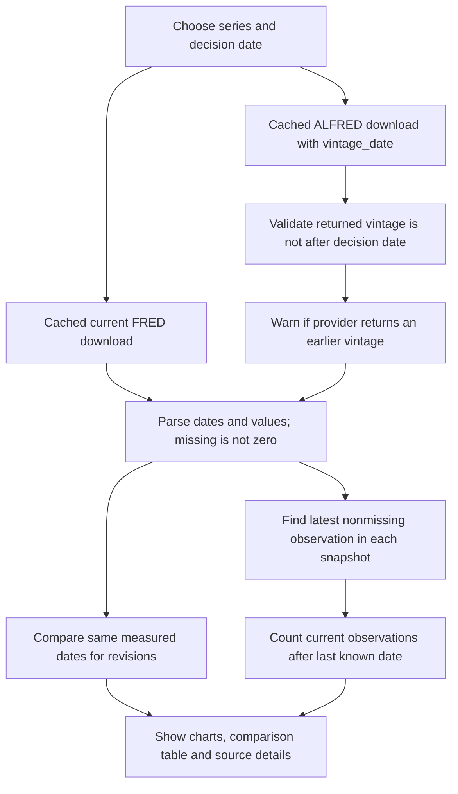

# Lab 17 — Point-in-Time Audit

> AI-use disclosure: Prepared with OpenAI Codex assistance; verify sources, code and conclusions.
> Educational purposes only. Not financial or investment advice.

Audit date: **29 October 2026** (America/New_York). Counts start at **1 January 2020**.
This file records computed evidence and AI-assisted explanations. Student-only exercises remain clearly marked.

## Question and finding

**Was each number knowable on the day I would have traded on it — and may Project 2 use it?**

An observation's measured month is different from its availability date. Project 2 can use a historical observation only after it was available, using the vintage available at that decision date. Today's revised history cannot automatically stand in for that history. An ALFRED date snapshot does not establish availability before a particular intraday trade.

The four course rate checks pass. The payroll probe demonstrates why the distinction matters. The chosen CPI series can support historical analysis subject to vintage and release-time controls; it is an index, not a fund price, return or interest rate. A final student decision is not recorded here.

## Run the app

From PowerShell:

```powershell
cd C:\Users\mac10\finance-ai-work\Lab_17
& "..\Lab_14\.venv\Scripts\python.exe" -m streamlit run asof_app.py --server.port 8503 --server.address 127.0.0.1 --browser.gatherUsageStats false
```

Open http://localhost:8503. Select the series and decision date. Expand a series' audit details to inspect individual dates and source URLs. Changing the chart start changes the chart and count window; it does not redefine the last available observation.

To verify:

```powershell
& "..\Lab_14\.venv\Scripts\python.exe" -B verify_lab17.py
& "..\Lab_14\.venv\Scripts\python.exe" -B test_asof_app.py
```

The verifier reuses successful source downloads from the same download day. Later days fetch fresh data and can legitimately change the current column and revision counts.

## Known answer: as known on 5 October 2026

| Series | Latest measured date then | Value then | Result |
| --- | --- | ---: | --- |
| BAA | September 2026 | 6.47% | Pass |
| FEDFUNDS | September 2026 | 3.75% | Pass |
| DGS10 | 2 October 2026 | 5.28% | Pass |
| MORTGAGE30US | 1 October 2026 | 7.28% | Pass |

Values come from the ALFRED responses, not the answer table inserted into the app. Expected values appear only in the verification script as assertions.

## Payroll revision probe

For PAYEMS as known on **15 January 2025**, the latest observation is **December 2024: 159,536 thousand persons**.
The current download's value for that SAME month is **158,316 thousand persons**, a revision of **−1,220 thousand persons**.
There are **59 revised same-date observations** from January 2020 onward and **21 later observations** beyond December 2024.

The latest current observation, September 2026 at 159,044, is a different month. Comparing that number directly with December 2024 would mix new observations with revisions.

Sources: [PAYEMS](https://fred.stlouisfed.org/series/PAYEMS), [January 15 vintage CSV](https://alfred.stlouisfed.org/graph/alfredgraph.csv?id=PAYEMS&vintage_date=2025-01-15).

## Own-series data card: CPIAUCSL

| Field | Evidence |
| --- | --- |
| Series | Consumer Price Index for All Urban Consumers: All Items in U.S. City Average (CPIAUCSL) |
| Original publisher | U.S. Bureau of Labor Statistics |
| Current source | [FRED series page](https://fred.stlouisfed.org/series/CPIAUCSL) and [current CSV](https://fred.stlouisfed.org/graph/fredgraph.csv?id=CPIAUCSL) |
| Historical source | [ALFRED September 30 snapshot](https://alfred.stlouisfed.org/graph/alfredgraph.csv?id=CPIAUCSL&vintage_date=2026-09-30) and [requested October 29 snapshot](https://alfred.stlouisfed.org/graph/alfredgraph.csv?id=CPIAUCSL&vintage_date=2026-10-29) |
| Measures | Changes in consumer prices; an index level, not an asset price or yield |
| Units / frequency | Index, 1982–1984 = 100; seasonally adjusted; monthly |
| Publication lag | Measured month precedes publication. September was absent from the September 30 vintage and present in the later snapshot. FRED showed an October 14 update for September; this is 14 days after month-end, but the page's update timestamp alone is not proof of the original BLS publication time. |
| Revisions | Seasonally adjusted CPI can be revised annually for the previous five years. Zero revisions in this short comparison does not establish that the series is unrevised. |
| Download date | 2026-10-29; exact per-response timestamps, URLs and raw responses are preserved in Lab_17_source_snapshots.json |
| Availability limitation | The October 29 request returned a column labelled CPIAUCSL_20261028. It confirms the earlier snapshot; completeness through October 29 is unconfirmed. The app displays a warning. |
| Project 2 use | A candidate macroeconomic input, with the vintage and publication lag enforced. Do not substitute this index for adjusted fund prices or treat its level as a percentage return. |

Revision policy source: [BLS: using seasonally adjusted data](https://www.bls.gov/cpi/seasonal-adjustment/using-seasonally-adjusted-data.htm).
Vintage interpretation: [ALFRED download help](https://alfred.stlouisfed.org/help/downloaddata).

### Last month-end versus today

| Requested as-of date | Returned vintage | Latest measured month | Value then | Latest current value | Later values | Revised same dates |
| --- | --- | --- | ---: | ---: | ---: | ---: |
| 2026-09-30 | 2026-09-30 | August 2026 | 334.131 | September: 336.298 | 1 | 0 |
| 2026-10-29 | 2026-10-28 — flagged | September 2026 | 336.298 | September: 336.298 | 0 | 0 |

September vanishes when the decision date goes back to September 30: it was not in that available snapshot. No same-date changes were observed in these comparisons, within the selected window.

### Three values to check personally

The assistant compared these current values with the FRED series page. **The assignment's student check is still pending.** Open the page, compare each number yourself, and replace “pending” only after doing so.

| Measured month | Current index value | Student verification |
| --- | ---: | --- |
| July 2026 | 332.813 | Pending |
| August 2026 | 334.131 | Pending |
| September 2026 | 336.298 | Pending |

## How the app avoids look-ahead errors



The historical download function includes the selected vintage in its URL and its cache key. Header validation rejects a current-only or future-vintage response. Unknown IDs produce an error for that series while the others remain available. The chart is today's history; the table and expanded details make the historical comparison.

A measured date is never labelled as a publication date. A missing observation is excluded, never replaced by zero. Counts include nonmissing values from the chosen start date; revision counts compare only dates with a value in both snapshots.

## Source limitation found during this audit

For DGS10 and CPIAUCSL, requests dated October 29 returned October 28 column labels. The app records both dates and warns rather than implying an exact October 29 snapshot. October 5 training vintages and the January 15 payroll vintage returned the requested dates. This limitation must stay visible in any Project 2 use.

## Student and partner work — complete without AI where instructed

- **Opening explanation:** Name one rate affecting the fund universe and explain why to your partner. Partner's notes: pending.
- **Code explanation:** Explain download_asof line by line from the source. Partner's question and your answer: pending.
- **Three-value check:** Personally compare the CPI values above with FRED.
- **Partner attack:** Record whether the partner questions publication timing, revisions or units, and their actual question: pending.
- **Your two-sentence response:** Pending actual partner feedback; cite evidence from the app or source.
- **Project 2 decision:** Record your own decision and any condition required before use. Do not equate a passing software test with full data suitability.

## Files for review

- asof_app.py — application.
- Lab_17_point_in_time_audit.md — this data card and evidence.
- verify_lab17.py — repeatable live-source checks and snapshot saving.
- test_asof_app.py — software checks with explicitly synthetic fixtures.
- Lab_17_live_test_output.txt and Lab_17_software_test_output.txt — visible test results.
- Lab_17_audit_results.json — calculated results.
- Lab_17_source_snapshots.json — raw downloads, dates, URLs and parsed observations.
- requirements.txt — app dependencies.

Review the student-only fields before submitting GitHub links. No GitHub upload has been performed.


## Verification record

All five live known-answer/probe checks and all five software tests passed. The browser displayed four charts and the October 5 table with 6.47, 3.75, 5.28 and 7.28. Screenshot: Lab_17_app_check.png (AI-assisted app evidence; educational purposes only, not financial or investment advice). The software test log includes normal Streamlit bare-mode warnings.


## Analyst dashboard update — 29 October 2026

AI-use disclosure: Prepared with OpenAI Codex assistance. Educational purposes only. Not financial or investment advice.

The app now opens with latest readings and changes versus each series' previous nonmissing observation. Rate changes are expressed in basis points (one percentage point equals 100 bp); macro levels use their native units. The comparison date and frequency appear beside each reading.

Each series includes a finance-oriented research context. The historical section separates revisions to the same observation from newly released observations, preserving the original point-in-time calculations and source warnings.

At the bottom, **All series · comparison chart** overlays the selected series. The information-set control switches between today's history and the selected historical snapshot. For rates, the default scale is percent. An optional indexed view sets each series to 100 in the first shared month with positive values. Adding a series with different or unverified units automatically uses that indexed comparison.

The overlay uses monthly averages of available observations. Individual charts retain original frequencies. Missing months remain missing; there is no forward fill. Partial first/latest months can be incomplete. The indexed lines measure relative changes in the underlying levels, not investment returns. Line differences are not automatically credit spreads because these instruments have different characteristics. Monthly plot labels identify measured months, not publication dates.

Verification: the original four rate answers and payroll probe still match the saved source snapshots. Software checks cover basis-point changes, monthly averaging, common-base rebasing, missing months, invalid vintages, caching, and the UI's mixed-unit and unknown-ID behavior. The overlay was also inspected in the browser in rate and indexed modes.

Screenshot: **Lab_17_rates_overlay.png** — AI-assisted app evidence, educational only and not financial or investment advice.

